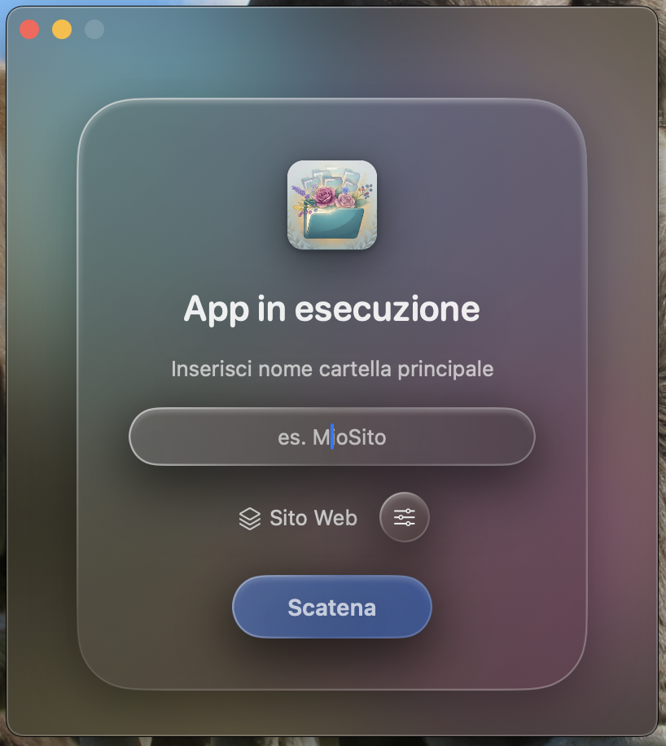
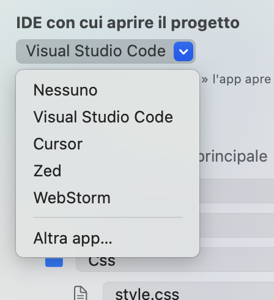

<a id="top"></a>

<p align="center">
  
</p>

<h1 align="center">WSiteFolderStart</h1>

<p align="center">
  <b>Scrivi un nome, premi Scatena: la struttura del tuo sito è pronta.</b>
</p>

<p align="center">
  <a href="https://github.com/WillyTv9/WSiteFolderStart/releases/latest/download/WSiteFolderStart-macOS.zip"></a>
  &nbsp;
  <a href="https://github.com/WillyTv9/WSiteFolderStart/releases/latest/download/WSiteFolderStart.exe"></a>
  &nbsp;
  <a href="https://github.com/WillyTv9/WSiteFolderStart/releases"></a>
</p>

<p align="center">
  <a href="https://github.com/WillyTv9/WSiteFolderStart/actions/workflows/build.yml"></a>
  
  
  <a href="LICENSE"></a>
</p>

<p align="center">
  
  &nbsp;&nbsp;
  
</p>

---

## Cos'è

WSiteFolderStart è una piccola app per **macOS** e **Windows** che prepara in un attimo la cartella di un nuovo progetto web. All'avvio compare una finestra leggera in stile "vetro liquido": scrivi il nome del progetto, premi **Scatena** e l'app crea la struttura, poi si chiude da sola.

La struttura predefinita è questa:

```
MioSito/
├── Html/
│   └── index.html
├── Css/
│   └── style.css
├── Php/
│   └── login.php
├── Js/
│   └── script.js
└── Img/            (vuota)
```

`index.html` nasce già collegato a `../Css/style.css` e `../Js/script.js`, con il nome del progetto come titolo. Gli altri file contengono solo un commento iniziale.

## Scarica

| Sistema | File | Stato |
|---|---|---|
| macOS 15 (Sequoia) o successivo | [`WSiteFolderStart-macOS.zip`](https://github.com/WillyTv9/WSiteFolderStart/releases/latest/download/WSiteFolderStart-macOS.zip) | Versione completa, con preset e IDE |
| Windows 10 / 11 (64 bit) | [`WSiteFolderStart.exe`](https://github.com/WillyTv9/WSiteFolderStart/releases/latest/download/WSiteFolderStart.exe) | **Beta**: stesse funzioni di macOS (preset personalizzabili e apertura nell'IDE), appena portate su Windows |

Tutte le versioni sono nella pagina [**Releases**](https://github.com/WillyTv9/WSiteFolderStart/releases).

## Primo avvio

Le app non sono firmate con un certificato a pagamento, quindi la prima volta il sistema chiede una conferma. È normale e si fa una volta sola.

### macOS

1. Scarica `WSiteFolderStart-macOS.zip` e fai doppio clic per decomprimerlo.
2. Trascina `WSiteFolderStart.app` nella cartella **Applicazioni**.
3. Apri l'app. macOS mostrerà un avviso del tipo *«WSiteFolderStart non è stata aperta»* o *«Apple non è in grado di verificare…»*. Premi **Fine** (o **OK**).
4. Apri **Impostazioni di Sistema → Privacy e sicurezza**, scorri fino alla sezione *Sicurezza* e premi **Apri comunque** accanto al nome dell'app. Conferma con la password o con Touch ID.
5. Da qui in poi l'app si apre normalmente.

> Da macOS 15 (Sequoia) il vecchio trucco "tasto destro → Apri" non basta più: serve il passaggio da *Privacy e sicurezza*.

In alternativa, da Terminale (un solo comando, poi l'app si apre senza avvisi):

```bash
xattr -dr com.apple.quarantine /Applications/WSiteFolderStart.app
```

**Permesso per le cartelle.** La prima volta che crei un progetto macOS può chiedere se l'app può accedere alla *Scrivania* (o a *Documenti* / *Download*, secondo la destinazione del preset). Premi **Consenti**: serve proprio a creare la cartella lì. Se hai rifiutato per sbaglio, puoi cambiarlo in *Impostazioni di Sistema → Privacy e sicurezza → File e cartelle*.

Se compili l'app tu stesso dai sorgenti (vedi sotto) questi avvisi non compaiono.

### Windows

1. Scarica `WSiteFolderStart.exe` e mettilo dove vuoi: non richiede installazione né .NET.
2. Al primo avvio può comparire la schermata blu **«Windows ha protetto il PC»**. Premi **Ulteriori informazioni** e poi **Esegui comunque**.

## Preset e IDE

Disponibili su macOS e su Windows. Gli screenshot qui sotto sono della versione macOS; su Windows la finestra ha gli stessi contenuti.

<p align="center">
  
</p>

Il menu con l'icona delle carte, sotto il campo del nome, sceglie il **preset** da usare. Il pulsante con i cursori accanto apre la finestra **Preset e IDE**, dove puoi:

- **creare, duplicare ed eliminare** preset (colonna a sinistra);
- cambiare il **nome** del preset e la **cartella di destinazione**, scrivendo il percorso o con *Scegli…*;
- scegliere l'**IDE** con cui aprire il progetto;
- costruire la **struttura** che vuoi: cartelle e file annidati senza limiti, da rinominare, eliminare e riempire con il contenuto che preferisci (icona con le righe accanto a ogni file).

Nei nomi e nel contenuto dei file puoi usare questi segnaposto:

| Segnaposto | Diventa |
|---|---|
| `{{nome}}` | il nome scritto nella finestra principale |
| `{{data}}` | la data di oggi (gg/mm/aaaa) |
| `{{anno}}` | l'anno corrente |

Una cartella senza elementi viene creata vuota, un file senza contenuto viene creato vuoto. Il preset predefinito si chiama **Sito Web** e riproduce la struttura mostrata sopra. I preset sono salvati in `~/Library/Application Support/WSiteFolderStart/presets.json` (macOS) o `%AppData%\WSiteFolderStart\presets.json` (Windows); se li cancelli tutti, l'app ricrea quello predefinito.

**Destinazione su Windows.** Il percorso può contenere `~` (la cartella utente), `%DESKTOP%` e `%DOCUMENTS%`. Il valore predefinito è `%DESKTOP%`, cioè il tuo Desktop reale, anche se è sincronizzato con OneDrive.

### Aprire il progetto nell'IDE

<p align="center">
  
</p>

Ogni preset ha il **proprio IDE**. L'app riconosce da sola quelli installati tra Visual Studio Code, Cursor, Windsurf, Zed, Sublime Text, WebStorm, PhpStorm, Nova e BBEdit su macOS (su Windows: Visual Studio Code, Cursor, Windsurf, Zed, Sublime Text, Notepad++, WebStorm e PhpStorm); con *Altra app…* puoi scegliere qualsiasi altra applicazione.

Se il preset ha un IDE, premendo **Scatena** l'app crea la struttura, apre la **cartella principale** nell'IDE (così un `index.html` non finisce nel browser) e poi si chiude. Se il preset è su *Nessuno*, crea e basta. Se l'IDE non si riesce ad aprire, l'app resta aperta con un avviso: la cartella è comunque già stata creata.

## Come si comporta

- La cartella viene creata nella destinazione del preset (di default il **Desktop**).
- **Non sovrascrive mai**: se la cartella o i file esistono già, aggiunge solo ciò che manca.
- Nel nome i caratteri non ammessi vengono sostituiti con `-` (su macOS `/` e `:`; su Windows `\ / : * ? " < > |`).
- **Scatena** resta disattivato finché il campo del nome è vuoto. `Invio` equivale a premere Scatena.
- Se qualcosa va storto, l'errore compare nella finestra e l'app resta aperta.
- Il tema chiaro o scuro segue quello del sistema.
- Su Windows, sotto il campo del nome, compare il percorso completo in cui verrà creata la cartella.

**Per uscire senza creare nulla:**

| Sistema | Come |
|---|---|
| macOS | pallino rosso della finestra, `⌘Q`, oppure tasto destro sull'icona nel Dock → **Esci** |
| Windows | **X** della finestra oppure `Alt+F4` |

## Aspetto

- **macOS**: effetto "liquid glass" simulato, che funziona anche su Sequoia. Materiale sfocato traslucido, riflessi diagonali, bordo luminoso, ombre morbide e macchie di colore che si muovono lentamente dietro al vetro. Non usa le API esclusive di macOS 26.
- **Windows**: scheda di vetro con bordo luminoso, macchie di colore animate dietro e sfondo traslucido Acrylic su Windows 11 22H2 o successivo; sulle versioni precedenti viene usato uno sfondo pieno con gli stessi colori.

## Compilare dai sorgenti

**macOS** (servono solo i Command Line Tools, non Xcode):

```bash
xcode-select --install          # una sola volta
cd macos
chmod +x build.sh
./build.sh
```

Il risultato è `macos/WSiteFolderStart.app`, autonoma: puoi spostarla in Applicazioni e cancellare il resto del progetto.

**Windows** (serve il [.NET 8 SDK](https://dotnet.microsoft.com/download)):

```powershell
cd windows
dotnet publish -c Release
```

Il risultato è un unico file, `windows\bin\Release\net8.0-windows\win-x64\publish\WSiteFolderStart.exe`, che puoi spostare ovunque.

## Problemi comuni

| Problema | Cosa fare |
|---|---|
| macOS dice che l'app non può essere aperta | Vedi [Primo avvio](#macos): *Privacy e sicurezza → Apri comunque*, oppure il comando `xattr`. |
| La cartella non viene creata sul Desktop | Controlla il permesso in *Privacy e sicurezza → File e cartelle*. |
| Il mio IDE non compare nel menu | Scegli *Altra app…* e seleziona l'applicazione. |
| Voglio ripartire da zero con i preset | Chiudi l'app e cancella `presets.json` (percorso sopra): verrà ricreato il preset predefinito. |
| Windows mostra «Windows ha protetto il PC» | *Ulteriori informazioni → Esegui comunque*. |

## Struttura della repo

```
.
├── macos/
│   ├── main.swift       finestra principale e stile "vetro"
│   ├── Editor.swift     finestra Preset e IDE (editor della struttura)
│   ├── Models.swift     preset, salvataggio, elenco IDE e creazione cartelle
│   ├── Info.plist       dati del bundle e testi dei permessi
│   ├── build.sh         compila e assembla WSiteFolderStart.app
│   └── icon.png         icona sorgente
├── windows/
│   ├── Program.cs       finestra principale
│   ├── EditorWindow.cs  finestra Preset e IDE
│   ├── Models.cs        preset, salvataggio, elenco IDE e creazione cartelle
│   ├── Theme.cs         colori, sfondo traslucido e controlli di vetro
│   ├── WSiteFolderStart.csproj
│   ├── icon.ico
│   └── icon.png
├── assets/              icona e screenshot usati in questo README
├── .github/workflows/   compilazione automatica e pubblicazione delle release
├── .gitignore
├── LICENSE
└── README.md
```

## Pubblicare una nuova versione

Il workflow `build.yml` compila entrambe le app a ogni push. Per pubblicare una release basta creare un tag:

```bash
git tag v1.2
git push origin v1.2
```

Su GitHub compaiono nelle Releases `WSiteFolderStart-macOS.zip` e `WSiteFolderStart.exe`.

## Personalizzare

- **macOS**: destinazione, struttura e contenuto dei file si cambiano dai preset, senza toccare il codice.
- **Windows**: come su macOS, destinazione, struttura e contenuto dei file si cambiano dai preset.
- **Icona**: sostituisci `icon.png` (meglio almeno 1024×1024 px) e, per Windows, rigenera `icon.ico`.

Segnalazioni e idee sono benvenute nelle [Issues](https://github.com/WillyTv9/WSiteFolderStart/issues).

## Licenza

Distribuita con licenza [MIT](LICENSE).

<p align="right"><a href="#top">↑ torna su</a></p>

