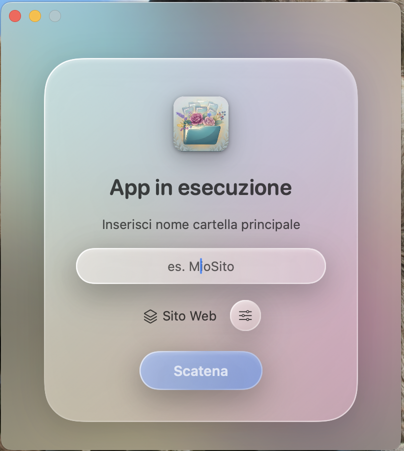
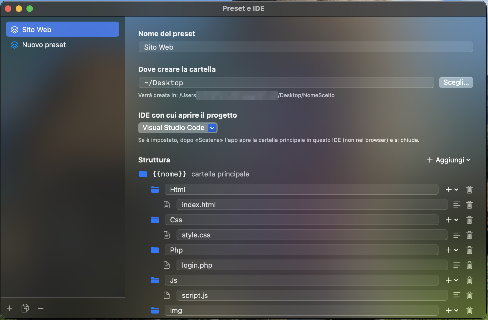

<a id="top"></a>

<p align="center">
  
</p>

<h1 align="center">WSiteFolderStart</h1>

<p align="center">
  <b>Scrivi un nome, premi Scatena: la struttura del tuo sito è pronta.</b><br>
  <b>Type a name, hit Scatena: your website scaffold is ready.</b>
</p>

<p align="center">
  <a href="https://github.com/WillyTv9/WSiteFolderStart/releases/latest/download/WSiteFolderStart-macOS.zip"></a>
  &nbsp;
  <a href="https://github.com/WillyTv9/WSiteFolderStart/releases/latest/download/WSiteFolderStart.exe"></a>
  &nbsp;
  <a href="https://github.com/WillyTv9/WSiteFolderStart/releases"></a>
</p>

<p align="center">
  <a href="https://github.com/WillyTv9/WSiteFolderStart/releases/latest"></a>
  <a href="https://github.com/WillyTv9/WSiteFolderStart/actions/workflows/build.yml"></a>
  
  
  <a href="LICENSE"></a>
</p>

<p align="center">
  <a href="#italiano">🇮🇹 Italiano</a> &nbsp;·&nbsp; <a href="#english">🇬🇧 English</a>
</p>

<p align="center">
  
  &nbsp;&nbsp;
  
</p>

---

## Italiano

### Cos'è

WSiteFolderStart è una piccola app per **macOS** e **Windows** che prepara in un attimo la cartella di un nuovo progetto web. All'avvio compare una finestra leggera in stile "vetro liquido": scrivi il nome del progetto, premi **Scatena** e l'app crea la struttura, poi si chiude da sola.

La struttura predefinita è questa:

```
MioSito/
├── Html/
│   └── index.html
├── Css/
│   └── style.css
├── Php/
│   └── login.php
├── Js/
│   └── script.js
└── Img/            (vuota)
```

`index.html` nasce già collegato a `../Css/style.css` e `../Js/script.js`, con il nome del progetto come titolo. Gli altri file contengono solo un commento iniziale.

### Scarica

| Sistema | File | Stato |
|---|---|---|
| macOS 15 (Sequoia) o successivo | [`WSiteFolderStart-macOS.zip`](https://github.com/WillyTv9/WSiteFolderStart/releases/latest/download/WSiteFolderStart-macOS.zip) | Versione completa, con preset e IDE |
| Windows 10 / 11 (64 bit) | [`WSiteFolderStart.exe`](https://github.com/WillyTv9/WSiteFolderStart/releases/latest/download/WSiteFolderStart.exe) | **Beta**: struttura fissa, senza preset né IDE |

Tutte le versioni sono nella pagina [**Releases**](https://github.com/WillyTv9/WSiteFolderStart/releases).

### Primo avvio

Le app non sono firmate con un certificato a pagamento, quindi la prima volta il sistema chiede una conferma. È normale e si fa una volta sola.

#### macOS

1. Scarica `WSiteFolderStart-macOS.zip` e fai doppio clic per decomprimerlo.
2. Trascina `WSiteFolderStart.app` nella cartella **Applicazioni**.
3. Apri l'app. macOS mostrerà un avviso del tipo *«WSiteFolderStart non è stata aperta»* o *«Apple non è in grado di verificare…»*. Premi **Fine** (o **OK**).
4. Apri **Impostazioni di Sistema → Privacy e sicurezza**, scorri fino alla sezione *Sicurezza* e premi **Apri comunque** accanto al nome dell'app. Conferma con la password o con Touch ID.
5. Da qui in poi l'app si apre normalmente.

> Da macOS 15 (Sequoia) il vecchio trucco "tasto destro → Apri" non basta più: serve il passaggio da *Privacy e sicurezza*.

In alternativa, da Terminale (un solo comando, poi l'app si apre senza avvisi):

```bash
xattr -dr com.apple.quarantine /Applications/WSiteFolderStart.app
```

**Permesso per le cartelle.** La prima volta che crei un progetto macOS può chiedere se l'app può accedere alla *Scrivania* (o a *Documenti* / *Download*, secondo la destinazione del preset). Premi **Consenti**: serve proprio a creare la cartella lì. Se hai rifiutato per sbaglio, puoi cambiarlo in *Impostazioni di Sistema → Privacy e sicurezza → File e cartelle*.

Se compili l'app tu stesso dai sorgenti (vedi sotto) questi avvisi non compaiono.

#### Windows

1. Scarica `WSiteFolderStart.exe` e mettilo dove vuoi: non richiede installazione né .NET.
2. Al primo avvio può comparire la schermata blu **«Windows ha protetto il PC»**. Premi **Ulteriori informazioni** e poi **Esegui comunque**.

### Preset e IDE (solo macOS)

<p align="center">
  
</p>

Il menu con l'icona delle carte, sotto il campo del nome, sceglie il **preset** da usare. Il pulsante con i cursori accanto apre la finestra **Preset e IDE**, dove puoi:

- **creare, duplicare ed eliminare** preset (colonna a sinistra);
- cambiare il **nome** del preset e la **cartella di destinazione**, scrivendo il percorso o con *Scegli…*;
- scegliere l'**IDE** con cui aprire il progetto;
- costruire la **struttura** che vuoi: cartelle e file annidati senza limiti, da rinominare, eliminare e riempire con il contenuto che preferisci (icona con le righe accanto a ogni file).

Nei nomi e nel contenuto dei file puoi usare questi segnaposto:

| Segnaposto | Diventa |
|---|---|
| `{{nome}}` | il nome scritto nella finestra principale |
| `{{data}}` | la data di oggi (gg/mm/aaaa) |
| `{{anno}}` | l'anno corrente |

Una cartella senza elementi viene creata vuota, un file senza contenuto viene creato vuoto. Il preset predefinito si chiama **Sito Web** e riproduce la struttura mostrata sopra. I preset sono salvati in `~/Library/Application Support/WSiteFolderStart/presets.json`; se li cancelli tutti, l'app ricrea quello predefinito.

#### Aprire il progetto nell'IDE

<p align="center">
  
</p>

Ogni preset ha il **proprio IDE**. L'app riconosce da sola quelli installati tra Visual Studio Code, Cursor, Windsurf, Zed, Sublime Text, WebStorm, PhpStorm, Nova e BBEdit; con *Altra app…* puoi scegliere qualsiasi altra applicazione.

Se il preset ha un IDE, premendo **Scatena** l'app crea la struttura, apre la **cartella principale** nell'IDE (così un `index.html` non finisce nel browser) e poi si chiude. Se il preset è su *Nessuno*, crea e basta. Se l'IDE non si riesce ad aprire, l'app resta aperta con un avviso: la cartella è comunque già stata creata.

### Come si comporta

- La cartella viene creata nella destinazione del preset (di default il **Desktop**).
- **Non sovrascrive mai**: se la cartella o i file esistono già, aggiunge solo ciò che manca.
- Nel nome i caratteri non ammessi vengono sostituiti con `-` (su macOS `/` e `:`; su Windows `\ / : * ? " < > |`).
- **Scatena** resta disattivato finché il campo del nome è vuoto. `Invio` equivale a premere Scatena.
- Se qualcosa va storto, l'errore compare nella finestra e l'app resta aperta.
- Il tema chiaro o scuro segue quello del sistema.
- Su Windows, sotto il campo del nome, compare il percorso completo in cui verrà creata la cartella.

**Per uscire senza creare nulla:**

| Sistema | Come |
|---|---|
| macOS | pallino rosso della finestra, `⌘Q`, oppure tasto destro sull'icona nel Dock → **Esci** |
| Windows | **X** della finestra oppure `Alt+F4` |

### Aspetto

- **macOS**: effetto "liquid glass" simulato, che funziona anche su Sequoia. Materiale sfocato traslucido, riflessi diagonali, bordo luminoso, ombre morbide e macchie di colore che si muovono lentamente dietro al vetro. Non usa le API esclusive di macOS 26.
- **Windows**: sfondo traslucido Acrylic su Windows 11 22H2 o successivo; sulle versioni precedenti viene usato uno sfondo pieno con gli stessi colori.

### Compilare dai sorgenti

**macOS** (servono solo i Command Line Tools, non Xcode):

```bash
xcode-select --install          # una sola volta
cd macos
chmod +x build.sh
./build.sh
```

Il risultato è `macos/WSiteFolderStart.app`, autonoma: puoi spostarla in Applicazioni e cancellare il resto del progetto.

**Windows** (serve il [.NET 8 SDK](https://dotnet.microsoft.com/download)):

```powershell
cd windows
dotnet publish -c Release
```

Il risultato è un unico file, `windows\bin\Release\net8.0-windows\win-x64\publish\WSiteFolderStart.exe`, che puoi spostare ovunque.

### Problemi comuni

| Problema | Cosa fare |
|---|---|
| macOS dice che l'app non può essere aperta | Vedi [Primo avvio](#macos): *Privacy e sicurezza → Apri comunque*, oppure il comando `xattr`. |
| La cartella non viene creata sul Desktop | Controlla il permesso in *Privacy e sicurezza → File e cartelle*. |
| Il mio IDE non compare nel menu | Scegli *Altra app…* e seleziona l'applicazione. |
| Voglio ripartire da zero con i preset | Chiudi l'app e cancella `presets.json` (percorso sopra): verrà ricreato il preset predefinito. |
| Windows mostra «Windows ha protetto il PC» | *Ulteriori informazioni → Esegui comunque*. |

### Struttura della repo

```
.
├── macos/
│   ├── main.swift       finestra principale e stile "vetro"
│   ├── Editor.swift     finestra Preset e IDE (editor della struttura)
│   ├── Models.swift     preset, salvataggio, elenco IDE e creazione cartelle
│   ├── Info.plist       dati del bundle e testi dei permessi
│   ├── build.sh         compila e assembla WSiteFolderStart.app
│   └── icon.png         icona sorgente
├── windows/
│   ├── Program.cs       app WPF
│   ├── WSiteFolderStart.csproj
│   ├── icon.ico
│   └── icon.png
├── assets/              icona e screenshot usati in questo README
├── .github/workflows/   compilazione automatica e pubblicazione delle release
├── .gitignore
├── LICENSE
└── README.md
```

### Pubblicare una nuova versione

Il workflow `build.yml` compila entrambe le app a ogni push. Per pubblicare una release basta creare un tag:

```bash
git tag v1.2
git push origin v1.2
```

Su GitHub compaiono nelle Releases `WSiteFolderStart-macOS.zip` e `WSiteFolderStart.exe`.

### Personalizzare

- **macOS**: destinazione, struttura e contenuto dei file si cambiano dai preset, senza toccare il codice.
- **Windows**: la destinazione (`SpecialFolder.Desktop`) e il contenuto dei file (funzione `Scatena`) sono in `windows/Program.cs`.
- **Icona**: sostituisci `icon.png` (meglio almeno 1024×1024 px) e, per Windows, rigenera `icon.ico`.

Segnalazioni e idee sono benvenute nelle [Issues](https://github.com/WillyTv9/WSiteFolderStart/issues).

### Licenza

Distribuita con licenza [MIT](LICENSE).

<p align="right"><a href="#top">↑ torna su / back to top</a></p>

---

## English

### What it is

WSiteFolderStart is a small app for **macOS** and **Windows** that scaffolds a new web project folder in a second. On launch you get a light "liquid glass" window: type the project name, hit **Scatena** ("Unleash") and the app creates the structure, then quits on its own.

The default structure is:

```
MySite/
├── Html/
│   └── index.html
├── Css/
│   └── style.css
├── Php/
│   └── login.php
├── Js/
│   └── script.js
└── Img/            (empty)
```

`index.html` comes already linked to `../Css/style.css` and `../Js/script.js`, with the project name as its title. The other files only contain a leading comment.

### Download

| System | File | Status |
|---|---|---|
| macOS 15 (Sequoia) or later | [`WSiteFolderStart-macOS.zip`](https://github.com/WillyTv9/WSiteFolderStart/releases/latest/download/WSiteFolderStart-macOS.zip) | Full version, with presets and IDE support |
| Windows 10 / 11 (64-bit) | [`WSiteFolderStart.exe`](https://github.com/WillyTv9/WSiteFolderStart/releases/latest/download/WSiteFolderStart.exe) | **Beta**: fixed structure, no presets or IDE |

All versions are on the [**Releases**](https://github.com/WillyTv9/WSiteFolderStart/releases) page.

### First launch

The apps are not signed with a paid certificate, so the system asks for a confirmation the first time. This is expected and only needed once.

#### macOS

1. Download `WSiteFolderStart-macOS.zip` and double-click it to unzip.
2. Drag `WSiteFolderStart.app` into the **Applications** folder.
3. Open the app. macOS shows a warning such as *"WSiteFolderStart was not opened"* or *"Apple could not verify…"*. Click **Done** (or **OK**).
4. Open **System Settings → Privacy & Security**, scroll to the *Security* section and click **Open Anyway** next to the app's name. Confirm with your password or Touch ID.
5. From now on the app opens normally.

> Since macOS 15 (Sequoia) the old "right-click → Open" trick is no longer enough: you have to go through *Privacy & Security*.

Alternatively, from Terminal (one command, then the app opens without warnings):

```bash
xattr -dr com.apple.quarantine /Applications/WSiteFolderStart.app
```

**Folder access.** The first time you create a project macOS may ask whether the app can access your *Desktop* (or *Documents* / *Downloads*, depending on the preset's destination). Click **Allow**: that is exactly what lets it create the folder there. If you denied it by mistake, change it in *System Settings → Privacy & Security → Files & Folders*.

If you build the app yourself from source (see below) none of these warnings appear.

#### Windows

1. Download `WSiteFolderStart.exe` and put it anywhere: no installer and no .NET needed.
2. On first launch you may see the blue **"Windows protected your PC"** screen. Click **More info**, then **Run anyway**.

### Presets and IDE (macOS only)

<p align="center">
  
</p>

The menu with the stacked-cards icon, under the name field, picks the **preset** to use. The sliders button next to it opens the **Preset e IDE** window, where you can:

- **create, duplicate and delete** presets (left column);
- change the preset's **name** and **destination folder**, by typing the path or with *Scegli…* (Choose…);
- pick the **IDE** used to open the project;
- build the **structure** you want: unlimited nested folders and files, which you can rename, delete and fill with any content (lines icon next to each file).

In names and file contents you can use these placeholders:

| Placeholder | Becomes |
|---|---|
| `{{nome}}` | the name typed in the main window |
| `{{data}}` | today's date (dd/mm/yyyy) |
| `{{anno}}` | the current year |

A folder with no items is created empty, a file with no content is created empty. The default preset is called **Sito Web** and reproduces the structure shown above. Presets are stored in `~/Library/Application Support/WSiteFolderStart/presets.json`; if you delete them all, the app recreates the default one.

#### Opening the project in your IDE

<p align="center">
  
</p>

Every preset has **its own IDE**. The app detects the installed ones among Visual Studio Code, Cursor, Windsurf, Zed, Sublime Text, WebStorm, PhpStorm, Nova and BBEdit; with *Altra app…* (Other app…) you can pick any other application.

If the preset has an IDE, pressing **Scatena** creates the structure, opens the **main folder** in the IDE (so an `index.html` doesn't end up in the browser) and then quits. If the preset is set to *Nessuno* (None), it just creates the folders. If the IDE can't be opened, the app stays open with a warning: the folder has already been created anyway.

### How it behaves

- The folder is created in the preset's destination (the **Desktop** by default).
- It **never overwrites**: if the folder or files already exist, it only adds what's missing.
- Characters not allowed in names are replaced with `-` (on macOS `/` and `:`; on Windows `\ / : * ? " < > |`).
- **Scatena** stays disabled while the name field is empty. `Return` works as pressing Scatena.
- If something goes wrong, the error appears in the window and the app stays open.
- The light or dark theme follows the system.
- On Windows, below the name field, you see the full path where the folder will be created.

**To quit without creating anything:**

| System | How |
|---|---|
| macOS | red window button, `⌘Q`, or right-click the Dock icon → **Quit** |
| Windows | the window's **X**, or `Alt+F4` |

### Look and feel

- **macOS**: a simulated "liquid glass" effect that also works on Sequoia. Translucent blurred material, diagonal highlights, a glowing edge, soft shadows and slowly moving color blobs behind the glass. It doesn't use the macOS 26-only APIs.
- **Windows**: translucent Acrylic backdrop on Windows 11 22H2 or later; on older versions a solid background with the same colors is used.

### Build from source

**macOS** (only the Command Line Tools are needed, not Xcode):

```bash
xcode-select --install          # once
cd macos
chmod +x build.sh
./build.sh
```

The result is `macos/WSiteFolderStart.app`, fully self-contained: you can move it to Applications and delete the rest of the project.

**Windows** (needs the [.NET 8 SDK](https://dotnet.microsoft.com/download)):

```powershell
cd windows
dotnet publish -c Release
```

The result is a single file, `windows\bin\Release\net8.0-windows\win-x64\publish\WSiteFolderStart.exe`, which you can move anywhere.

### Troubleshooting

| Problem | What to do |
|---|---|
| macOS says the app can't be opened | See [First launch](#macos-1): *Privacy & Security → Open Anyway*, or the `xattr` command. |
| The folder isn't created on the Desktop | Check the permission in *Privacy & Security → Files & Folders*. |
| My IDE isn't in the menu | Choose *Altra app…* and select the application. |
| I want to reset my presets | Quit the app and delete `presets.json` (path above): the default preset is recreated. |
| Windows shows "Windows protected your PC" | *More info → Run anyway*. |

### Repository layout

```
.
├── macos/
│   ├── main.swift       main window and "glass" styling
│   ├── Editor.swift     Presets and IDE window (structure editor)
│   ├── Models.swift     presets, storage, IDE list and folder creation
│   ├── Info.plist       bundle info and permission strings
│   ├── build.sh         builds and assembles WSiteFolderStart.app
│   └── icon.png         source icon
├── windows/
│   ├── Program.cs       WPF app
│   ├── WSiteFolderStart.csproj
│   ├── icon.ico
│   └── icon.png
├── assets/              icon and screenshots used in this README
├── .github/workflows/   automatic builds and releases
├── .gitignore
├── LICENSE
└── README.md
```

### Publishing a new version

The `build.yml` workflow builds both apps on every push. To publish a release, just create a tag:

```bash
git tag v1.2
git push origin v1.2
```

`WSiteFolderStart-macOS.zip` and `WSiteFolderStart.exe` then appear in the Releases.

### Customizing

- **macOS**: destination, structure and file contents are changed from the presets, no code needed.
- **Windows**: the destination (`SpecialFolder.Desktop`) and the file contents (the `Scatena` function) live in `windows/Program.cs`.
- **Icon**: replace `icon.png` (ideally at least 1024×1024 px) and, for Windows, regenerate `icon.ico`.

Bug reports and ideas are welcome in the [Issues](https://github.com/WillyTv9/WSiteFolderStart/issues).

### License

Released under the [MIT](LICENSE) license.

<p align="right"><a href="#top">↑ back to top / torna su</a></p>
