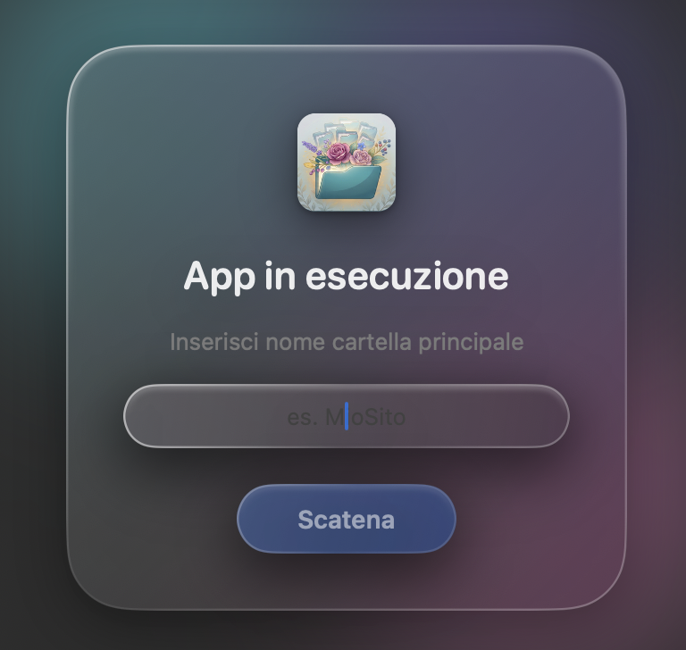

<p align="center">
  
</p>

<h1 align="center">WSiteFolderStart</h1>

<p align="center">
  Scrivi un nome, premi <b>Scatena</b>, e la struttura del tuo sito web è pronta.<br>
  App per <b>macOS</b> e <b>Windows</b> con interfaccia in stile "vetro liquido".
</p>

<p align="center">
  
</p>

---

## Cosa fa

All'avvio compare una piccola finestra con la scritta **"App in esecuzione"**, il campo **"Inserisci nome cartella principale"** e il pulsante **Scatena**. Premendo Scatena (o Invio) l'app crea sul **Desktop** questa struttura e poi si chiude da sola:

```
NomeScelto/
├── Html/
│   └── index.html
├── Css/
│   └── style.css
├── Php/
│   └── login.php
├── Js/
│   └── script.js
└── Img/            (vuota)
```

### Contenuto dei file creati

| File | Contenuto iniziale |
|------|--------------------|
| `Html/index.html` | Pagina HTML5 con il nome scelto come titolo, già collegata a `../Css/style.css` e `../Js/script.js` |
| `Css/style.css` | Un commento con il nome del progetto |
| `Php/login.php` | Apertura `<?php` e un commento con il nome del progetto |
| `Js/script.js` | Un commento con il nome del progetto |
| `Img/` | Cartella vuota |

### Regole di comportamento

- La cartella viene creata sul **Desktop** dell'utente. Su macOS la destinazione dipende dal preset scelto (vedi sotto) e di default è il Desktop.
- Se la cartella o i file esistono già, **non vengono mai sovrascritti**: viene aggiunto solo ciò che manca.
- Nel nome, i caratteri non ammessi dal sistema (come `/` e `:` su Mac, o `\ / : * ? " < > |` su Windows) vengono sostituiti con `-`.
- Il pulsante Scatena resta disattivato finché il campo è vuoto.
- Se qualcosa va storto (per esempio manca il permesso di scrittura) l'errore compare nella finestra e l'app resta aperta.

### Come uscire senza creare nulla

| Sistema | Modi per chiudere |
|---------|-------------------|
| macOS | Pallino rosso della finestra, `⌘Q`, oppure tasto destro sull'icona nel Dock → **Esci** |
| Windows | **X** della finestra oppure `Alt+F4` |

## Preset e IDE (solo macOS)

Dalla versione 1.2 l'app per macOS permette di scegliere *cosa* creare e di aprire subito il progetto nel tuo editor.

**Preset.** Nella finestra principale, sotto il campo del nome, il menu con l'icona delle carte sceglie il preset da usare. Il preset predefinito si chiama **Sito Web** e crea la struttura descritta sopra. Il pulsante con i cursori accanto al menu apre la finestra **Preset e IDE**, dove puoi:

- creare, duplicare ed eliminare preset (a sinistra);
- cambiare il **nome** del preset e la **cartella di destinazione** (campo di testo oppure *Scegli…*) e l'**IDE** con cui aprire il progetto;
- costruire la **struttura** a piacere: aggiungere cartelle e file annidati quanto vuoi, rinominarli, eliminarli e scrivere il contenuto di ogni file;
- usare i segnaposto `{{nome}}` (il nome scritto nella finestra principale), `{{data}}` e `{{anno}}`, sia nei nomi sia nel contenuto.

I preset si salvano in `~/Library/Application Support/WSiteFolderStart/presets.json`. Se li cancelli tutti, l'app ricrea il preset predefinito.

**IDE per preset.** Ogni preset ha il proprio IDE, impostato nella finestra *Preset e IDE* subito sotto la cartella di destinazione. L'app riconosce da sola quelli installati tra Visual Studio Code, Cursor, Windsurf, Zed, Sublime Text, WebStorm, PhpStorm, Nova e BBEdit, oppure puoi indicare qualsiasi altra app con *Altra app…*. Se il preset scelto ha un IDE, premendo **Scatena** l'app crea la struttura, apre la **cartella principale** nell'IDE (così un `index.html` non finisce nel browser) e poi si chiude. Se il preset non ha un IDE, crea e basta. Cambiando preset cambia anche l'IDE.

La versione per Windows non ha ancora preset né apertura nell'IDE.

## Aspetto

- **macOS** – Effetto "liquid glass" simulato: materiale sfocato traslucido, riflessi diagonali, bordo luminoso, ombre morbide e macchie di colore che si muovono lentamente dietro al vetro. Funziona anche su macOS 15 (Sequoia) e non usa le API esclusive di macOS 26.
- **Windows** – Sfondo traslucido Acrylic su Windows 11 (22H2 o successivo); su Windows 10 e sulle versioni precedenti di Windows 11 viene usato uno sfondo pieno con gli stessi colori. L'app mostra anche, sotto il campo di testo, il **percorso completo** in cui verrà creata la cartella.
- **Tema** – Su entrambi i sistemi segue automaticamente il tema chiaro o scuro del sistema.

## Requisiti

| | macOS | Windows |
|---|---|---|
| Sistema | macOS 15 (Sequoia) o successivo | Windows 10 / 11, 64 bit |
| Per usarla | niente | niente (l'`.exe` include già .NET) |
| Per compilarla | Command Line Tools di Apple (non serve Xcode) | .NET 8 SDK |

## Installazione dalle Releases

### macOS
1. Scarica `WSiteFolderStart-macOS.zip` dalla pagina [Releases](../../releases) e decomprimilo.
2. Trascina `WSiteFolderStart.app` in **Applicazioni**.
3. Alla prima apertura macOS potrebbe bloccarla perché non è notarizzata da Apple: fai **tasto destro → Apri → Apri**. In alternativa, da Terminale:
   ```bash
   xattr -dr com.apple.quarantine /Applications/WSiteFolderStart.app
   ```
4. Alla prima creazione macOS chiede il permesso di accedere alla **Scrivania**: è necessario per creare la cartella lì.

### Windows
1. Scarica `WSiteFolderStart.exe` dalla pagina [Releases](../../releases).
2. Mettilo dove vuoi ed eseguilo. Non richiede installazione né .NET.
3. Se compare la schermata blu di SmartScreen ("Windows ha protetto il PC"), premi **Ulteriori informazioni → Esegui comunque**: l'app non è firmata con un certificato a pagamento.

## Compilare dai sorgenti

### macOS
```bash
xcode-select --install          # una sola volta: installa i Command Line Tools
cd macos
chmod +x build.sh
./build.sh
```
Lo script compila i file `.swift`, genera l'icona `.icns` partendo da `icon.png`, assembla il bundle e lo firma in locale. Il risultato è `macos/WSiteFolderStart.app`, che è autonoma: puoi spostarla in Applicazioni e cancellare il resto del progetto.

### Windows
```powershell
cd windows
dotnet publish -c Release
```
Il risultato è un unico file: `windows\bin\Release\net8.0-windows\win-x64\publish\WSiteFolderStart.exe`. È autonomo e può essere spostato ovunque.

## Struttura della repo

```
.
├── macos/
│   ├── main.swift       finestra principale e stile "vetro"
│   ├── Editor.swift     finestra Preset e IDE (editor della struttura)
│   ├── Models.swift     preset, salvataggio, elenco IDE e creazione cartelle
│   ├── Info.plist       informazioni del bundle e testo del permesso Scrivania
│   ├── build.sh         compila e assembla WSiteFolderStart.app
│   └── icon.png         icona sorgente
├── windows/
│   ├── Program.cs       app WPF (interfaccia e creazione cartelle)
│   ├── WSiteFolderStart.csproj
│   ├── icon.ico
│   └── icon.png
├── assets/              immagini usate in questo README
├── .github/workflows/   compilazione automatica e pubblicazione delle Releases
├── .gitignore
├── LICENSE
└── README.md
```

## Pubblicare una nuova versione

Il workflow `build.yml` compila entrambe le app a ogni push. Per pubblicare una release basta creare un tag:

```bash
git tag v1.0
git push origin v1.0
```

Su GitHub compariranno nelle Releases `WSiteFolderStart-macOS.zip` e `WSiteFolderStart.exe`.

## Personalizzare

- **Cartella di destinazione e contenuto dei file**: su macOS si cambiano dai preset (pulsante con i cursori nella finestra principale). Su Windows sono nel codice: `SpecialFolder.Desktop` e la funzione `Scatena` in `windows/Program.cs`.
- **Icona**: sostituisci `icon.png` (meglio se almeno 1024×1024 px) e, per Windows, rigenera `icon.ico`.

## Licenza

Distribuita con licenza [MIT](LICENSE).
